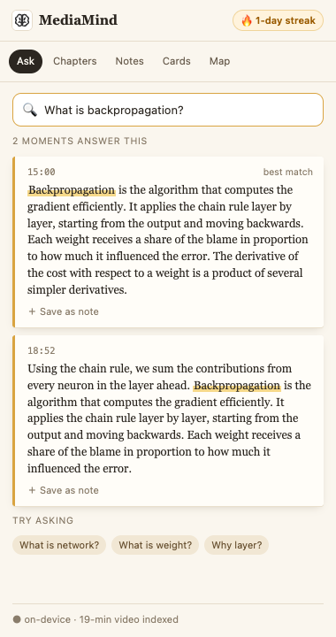
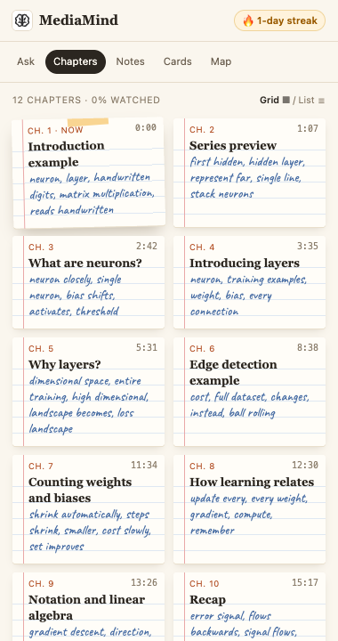
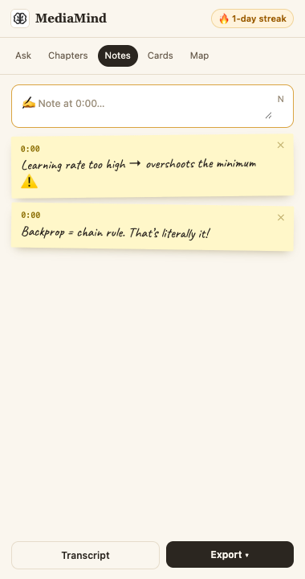

# MediaMind

**Turn any YouTube video into searchable moments, chapters and notes — right in your browser.**

Free forever · no account · no API key · nothing leaves your device.

<table>
  <tr>
    <td align="center"><br><sub>Welcome — नमस्ते in 10 languages</sub></td>
    <td align="center"><br><sub>Ask the video</sub></td>
    <td align="center"><br><sub>Chapters as index cards</sub></td>
    <td align="center"><br><sub>Timestamped notes</sub></td>
  </tr>
</table>

## What it does

MediaMind is a Chrome side panel for YouTube. Open a video, open the panel, and MediaMind reads the video's captions and builds a study kit for it on your machine:

- **Ask** — type a question and get the 3 moments in the video that answer it, with your words highlighted. Click a moment to jump there, or save it as a note. Suggested questions to get you started.
- **Chapters** — the creator's chapters, or auto-detected topics when there are none, shown as index cards with keywords. The chapter you're watching is taped down; watched chapters get a ✓. Key points for the current chapter underneath.
- **Notes** — press **N** in the panel (or **Alt+N** anywhere on YouTube) to pause and pin a note to the current second. Highlight lines in the transcript. Export everything as Markdown for Notion or Obsidian.
- **Transcript** — the full transcript, following the video as it plays. Click any line to jump.
- **Streak** — a 🔥 daily streak for days you ask, take notes or highlight.
- **Hindi and other languages** — the panel shows the original text; search uses YouTube's English translation behind the scenes.

Flashcards and a mind map are on the way (the **Cards** and **Map** tabs).

## How it works — no LLM, no server

Most video-summary extensions send your transcript to a paid AI service. MediaMind doesn't:

1. **Captions** come from YouTube's own player on the page you're already watching.
2. **Text processing** (pure TypeScript) splits the transcript into 25–40 s pieces, finds keywords, and detects chapter boundaries.
3. **Search** combines classic keyword ranking (BM25) with a small embedding model, [all-MiniLM-L6-v2](https://huggingface.co/Xenova/all-MiniLM-L6-v2) (~23 MB), that runs **inside the extension** via transformers.js. It's bundled — nothing is downloaded at runtime.
4. **Storage** is IndexedDB in your browser. No account, no sync, no analytics.

The only network traffic is to `youtube.com`, which you're already on.

## Install (developer build)

Requires Node 20+ and Chrome.

```bash
git clone https://github.com/pAbhit007/MediaMind.git
cd MediaMind
npm install
npm run build -w apps/extension   # first build downloads the model files once (~35 MB)
```

Then in Chrome:

1. Go to `chrome://extensions` and turn on **Developer mode**.
2. Click **Load unpacked** and choose `apps/extension/.output/chrome-mv3`
   (on macOS press **⌘ + Shift + G** in the picker and paste the path — the `.output` folder is hidden).
3. Pin MediaMind, open a YouTube video, and click the icon.

## Development

```bash
npm test --workspaces --if-present        # engine + extension tests
npm run typecheck --workspaces --if-present
npm run build -w apps/extension
npm run test:browser -w apps/extension    # real-Chromium check: model loads, no outside network requests
```

```
packages/engine/     pure TypeScript: captions, segmentation, keywords, BM25, search, chapters, pipeline
apps/extension/      WXT + React MV3 extension
  src/youtube/       everything YouTube-specific (caption capture, player control)
  src/worker/        on-device embedding + search in a Web Worker
  src/db/            IndexedDB storage, streak
  src/features/      welcome, ask, chapters, notes, transcript
docs/superpowers/    design spec and implementation plan
```

## Roadmap

| Wave | |
|---|---|
| **1 · Foundation** | ✅ Ask, Chapters, Notes, Transcript, streak, welcome |
| 2 · Learning loop | Flashcards with spaced repetition, Today screen, weekly recap, study timer |
| 3 · Visual & sharing | Mind map, quote cards, read mode, glossary, quiz me |
| 4 · YouTube helpers | Focus mode, skip sponsors |
| 5 · Website | Landing page, library, search across all your videos, playlists as courses |
| 6 · Expansion | Hindi & regional-language UI, sites beyond YouTube |

---

<sub>Screenshots are from the built extension on a 3Blue1Brown lecture.</sub>
